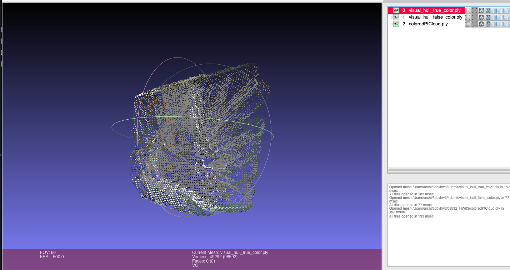

# CS 532 Homework 3 Notes: Voxel-Based Reconstruction

## The big picture
? How can multiple 2D Camera views be combined to estimate 3d shape?
? How do voxel grids & sillhouettes work?
? Why are visibility checks necessary for realistic colors and shadows?

Here, I reconstruct an approximate 3D dancer from multiple calibrated camera
images and their binary silhouettes. Instead of guessing a smooth surface
directly, I divide a known 3D region into small boxes called voxels. I keep
only boxes that agree with every silhouette, turn the boundary of the kept
boxes into a point cloud, color the points, and export them as a PLY model.

## TL;DR

- **Goal:** combine eight 2D camera views into one approximate 3D model of a
  dancer.
- **Silhouette:** a black-and-white image showing which pixels may belong to
  the dancer. It gives shape information, but not depth.
- **Voxel:** a small 3D box, similar to a pixel but with volume. I test each
  voxel as a possible part of the dancer.
- **Visual hull:** the voxels that remain possible from every camera. It should
  contain the real object, but it can fill in concavities that never change any
  silhouette.
- **Surface voxel:** an occupied voxel touching EMPTY space in one of its six
  axis-aligned directions.
- **Output point:** the center of an exposed voxel face. One surface voxel can
  create several output points.
- **False color:** color made from position. Red follows X, green follows Y,
  and blue follows Z. It helps me inspect the geometry.
- **True color:** RGB sampled from the original camera images. A sample is used
  only when the camera sees a foreground pixel and the 3D ray is not blocked.
- **Visibility:** I use 3D DDA, a grid ray-tracing method, to walk through the
  voxels between a point and a camera or light.
- **Point light:** a light source placed at one 3D location. For this bonus, I
  use `L1=(-4,-4,5)` and `L2=(4,2,4)` meters.
- **Shadow test:** a surface point is shadowed from a light when another
  occupied voxel blocks the point-to-light ray. Points blocked from both lights
  are darkened; points reached by at least one light are blended lighter.
- **Bonus output:** the projected light locations are marked with red pixels,
  and the annotated images are saved as PPM files in
  `submit/two_light_bonus/`.

The main process is:

```text
make a 100 x 120 x 50 voxel grid; start every voxel EMPTY

for each voxel center:
    project it into all eight cameras
    if any projection is behind a camera, outside an image, or background:
        reject the voxel
    otherwise:
        mark it OCCUPIED

find occupied voxels touching EMPTY neighbors
emit the center of every exposed voxel face as an output point

false color: map X, Y, Z to red, green, blue
true color: project each point, run a visibility ray, then median visible RGB
bonus: for each surface point, run point-to-light visibility rays
       darken points blocked from both lights
       lighten points reached by at least one light
       draw red markers for projected light locations
       save the eight annotated camera images
```

The most important results are 74,869 occupied voxels, 26,311 surface voxels,
and 49,292 output points. The assignment is interesting because it starts with
simple 2D silhouettes and ends with a measurable 3D shape, camera-aware colors,
and approximate shadows.

## Dataset and camera math

I have eight color images, eight silhouette images, and eight 3x4 camera
projection matrices. A world-space point is written in homogeneous form as

```text
X = [X, Y, Z, 1]^T.
```

For camera `i`, its projection matrix `P_i` is the calibration information
that tells me where a 3D point should appear in that image. It maps the point
to temporary image coordinates:

```text
[u_tilde, v_tilde, w_tilde]^T = P_i X.
u = u_tilde / w_tilde
v = v_tilde / w_tilde
```

After dividing by `w_tilde`, `(u, v)` is the pixel location in that camera. A projection is useful only
when `w_tilde` is positive and `(u, v)` lies inside the image. In my code, I
round the projected coordinates to the nearest pixel before reading a
silhouette or RGB value.

## 1. Define the voxel grid

A **voxel** is a three-dimensional pixel: a small box that represents a small
region of space. The smaller the voxels are, the more detail I can represent,
but the more boxes I have to test. The assignment bounding box is

```text
x in [-2.5, 2.5] meters
y in [-3.0, 3.0] meters
z in [ 0.0, 2.5] meters.
```

Choose `Nx`, `Ny`, and `Nz`, the number of voxels along x, y, and z. The voxel side lengths are

```text
dx = (xmax - xmin) / Nx
dy = (ymax - ymin) / Ny
dz = (zmax - zmin) / Nz.
```

Voxel `(ix, iy, iz)` has lower corner

```text
[xmin + ix*dx, ymin + iy*dy, zmin + iz*dz]
```

and center

```text
c(ix,iy,iz) = [xmin + (ix + 0.5)*dx,
               ymin + (iy + 0.5)*dy,
               zmin + (iz + 0.5)*dz].
```

There are `Nx * Ny * Nz` total voxels. Increasing the resolution makes the
shape less blocky, but also increases memory use and runtime. I found this to
be a tradeoff between seeing more detail and waiting longer for every camera
projection.

For the implementation, keep at least an occupancy array such as
`occupied[Nx, Ny, Nz]`. This code uses a one-byte flat `bytearray`; zero means
EMPTY and one means OCCUPIED. Initially, every value is zero.

## 2. Build the visual hull

Now I ask the same question for every voxel: “Would this voxel project inside
the dancer in every camera?” Each binary silhouette says which image pixels
might belong to the dancer. A
voxel is consistent with camera `i` when its center projects onto a foreground
silhouette pixel in that camera. The visual-hull occupancy test is

```text
occupied(v) = AND over cameras i of
              [project_i(center(v)) is valid AND silhouette_i(u_i, v_i) is foreground].
```

In plain language, I start by treating every voxel as possible dancer space.
Then I *reject* a voxel as soon as one camera sees its center outside the dancer
silhouette. This is the discrete version of intersecting the generalized cones
formed by back-projecting all of the silhouettes into 3D. Watching the 2D
silhouettes gradually turn into a 3D volume was one of the most satisfying
parts of the assignment.

The two numbers I keep track of are:

```text
visual_hull_count = number of occupied voxels
visual_hull_fraction = visual_hull_count / (Nx * Ny * Nz).
```

## 3. Find surface voxels

After carving, most kept voxels are inside the shape. I only need the boundary
for the point-cloud output, so I look for kept voxels that touch empty space. A
**surface voxel** is an occupied voxel with at least one neighboring voxel that
is empty. With 6-connected neighbors, the neighboring offsets are

```text
(+/-1, 0, 0), (0, +/-1, 0), (0, 0, +/-1).
```

For each occupied voxel, I inspect these six locations. A neighbor outside the
grid is treated as *empty* because the grid boundary *exposes a face.* The test is

```text
surface(v) = occupied(v) AND (at least one 6-neighbor is empty).
```

Interior occupied voxels are not surface voxels because they are completely surrounded by occupied volume. Report the surface count and `surface_count / total_voxel_count`.

## 4. Create the output geometry

The assignment asks for points rather than a closed triangle mesh. For every
surface voxel, I
add one point at the center of each face next to an empty neighbor. If the
voxel center is `(cx, cy, cz)`, the six possible face centers are

```text
(cx - dx/2, cy,          cz)          (cx + dx/2, cy,          cz)
(cx,          cy - dy/2, cz)          (cx,          cy + dy/2, cz)
(cx,          cy,          cz - dz/2) (cx,          cy,          cz + dz/2).
```

Add only the face corresponding to an empty neighbor. A surface voxel can have one through six exposed faces, so the output-point count is generally different from the number of surface voxels. Adjacent occupied voxels share an internal face, which is not emitted, while a voxel on a corner can contribute multiple points.

I also store the voxel index and outward face normal with each point. At first
this seemed like extra bookkeeping, but it becomes important when I need to
start a visibility ray just outside the surface.

## 5. Assign false colors

False color visualizes position, not the image appearance of the dancer. I
first find the coordinate bounds of the generated output points:

```text
Xmin, Xmax, Ymin, Ymax, Zmin, Zmax.
```

For a point `(X, Y, Z)`, assign

```text
R = round(255 * (X - Xmin) / (Xmax - Xmin))
G = round(255 * (Y - Ymin) / (Ymax - Ymin))
B = round(255 * (Z - Zmin) / (Zmax - Zmin)).
```

Clamp every result to `[0, 255]` and write it as an unsigned byte. If a range
such as `Xmax - Xmin` is zero, use a safe constant (for example 0 or 128) for
that channel instead of dividing by zero. This color scheme is a debugging
aid. Red changes along x, green along y, and blue along z, so flipped axes or
incorrectly positioned geometry are easier to notice.

## 6. Export the false-color PLY

Write an ASCII PLY header with an exact vertex count followed by one row per point:

```text
ply
format ascii 1.0
element vertex NUMBER_OF_POINTS
property float x
property float y
property float z
property uchar red
property uchar green
property uchar blue
element face 0
end_header
x y z r g b
```

The `element vertex` number must equal the actual number of data rows. Opening
the file in MeshLab is a useful reality check: does the silhouette look like a
dancer, and do the coordinate colors change in the directions I expected?


## 7. Assign true colors with visibility

This is where the reconstruction starts to look more like the original
photographs. A point may project onto a dancer-colored pixel even when another
part of the shape is actually in front of it. I need to check the path between
the point and the camera before trusting that pixel.

True color estimates each surface point's color from the eight RGB camera
images. Project the point into every camera with the camera math above. A
camera can contribute an RGB sample only when:

1. The projection is in front of the camera and inside the image.
2. The projected pixel is inside that camera's silhouette.
3. The camera has an unoccluded line of sight to the point.

The third condition matters because a camera may project a rear or hidden surface point onto a foreground pixel that actually belongs to a nearer part of the dancer. Using that pixel would paint the hidden point with the wrong color.

### A voxel ray-visibility method

For an output face point `q` and camera center `C`, form the segment

```text
r(t) = q + t(C - q), where 0 < t < 1.
```

Traverse the voxels crossed by this ray (using a grid ray traversal such as 3D DDA). The point is visible from that camera if every voxel between the surface point and the camera is empty. The source surface voxel itself should be skipped; otherwise it would incorrectly occlude itself. A practical variant starts the ray a tiny distance outside the exposed face, using the stored outward normal, to avoid numerical self-intersection.

For every visible camera, read its RGB value at the projected pixel. If the valid samples are `(R_j, G_j, B_j)`, use the per-channel median:

```text
R = median_j(R_j)
G = median_j(G_j)
B = median_j(B_j).
```

The median is robust to small calibration errors, silhouette-edge pixels, and a bad sample from one view. If no camera passes the visibility test, use and document the neutral-gray fallback `(128,128,128)`. The implementation then exports another ASCII PLY using the same geometry and the true RGB values.

## 8. Write the true-color PLY

The true-color pass writes `visual_hull_true_color.ply` using the same
face-center geometry as the false-color model. The file is ASCII PLY with
49,292 vertices and the RGB values produced by the visibility-aware camera
fusion.



## 9. Bonus: two point lights and 3D shadows

The bonus treats the occupied visual hull as an object that blocks light. Pick two light positions `L1` and `L2` outside the reconstructed volume. For each reconstructed surface point `p`, test whether light `L` reaches it with the segment

```text
s(t) = L + t(p - L), where 0 < t < 1.
```

If this segment intersects an occupied voxel before reaching `p`, the point is in shadow from that light. This is the same ray-occlusion idea used for camera visibility, but the ray starts at a light rather than a camera.

A straightforward implementation for this project is:

1. Use the two selected lights `L1=(-4,-4,5)` and `L2=(4,2,4)` meters.
2. For each reconstructed surface point and each light, traverse the grid along
   the point-to-light segment with the existing 3D DDA routine.
3. If another occupied voxel blocks both light rays, darken the point after it
   is projected into a camera image.
4. If at least one light can reach the point, blend the projected pixel toward
   white.
5. Project each light into the camera image and draw a red marker when it is
   inside the image.
6. Save one annotated PPM image per camera in `submit/two_light_bonus/`.

These are my favorite three camera views of the bonus result:


The implementation changes projected foreground surface pixels only. It does
not change the background. This is an approximate surface-point relighting
pass rather than a full volumetric shadow map.

These are approximate surface-point shadows because the object is a voxelized visual hull, not the exact dancer surface. That is acceptable as long as the method and limitations are stated clearly.

## What this assignment teaches

The purpose is to connect multi-view geometry, camera calibration, silhouettes, volumetric representations, and rendering in one pipeline. It demonstrates how multiple 2D views constrain 3D shape, why silhouette intersection produces a visual hull rather than an exact model, how to extract a usable surface point cloud from voxels, and how geometric visibility is needed for credible color and shadow estimates. The final PLY gives a concrete, inspectable result of that entire reconstruction process.

