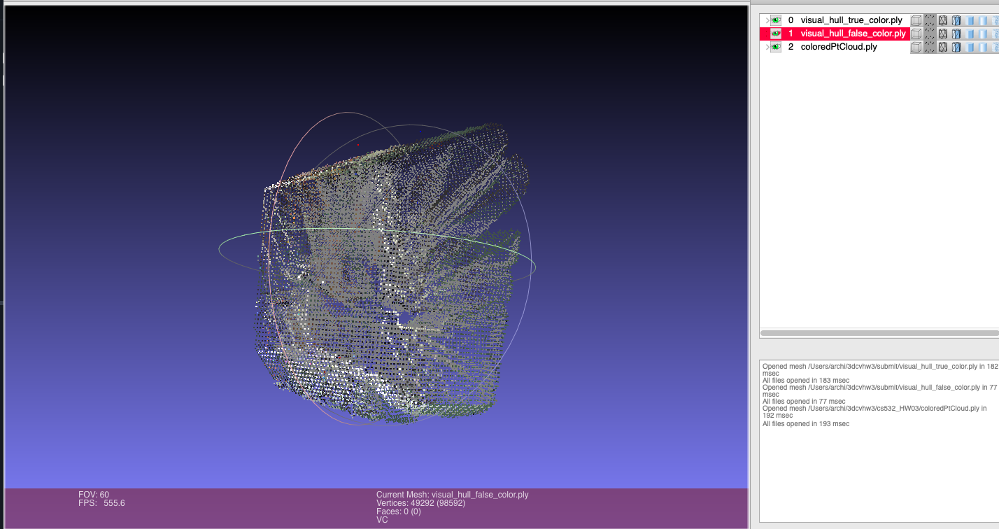

# CS 532 Homework 3: Voxel-Based Multi-View Reconstruction

? How can multiple 2D Camera views be combined to estimate 3d shape?
? How do voxel grids & sillhouettes work?
? Why are visibility checks necessary for realistic colors and shadows?

This project answers those questions by reconstructing a dancer from eight
calibrated camera images and eight binary silhouettes. I do not try to recover
a smooth surface directly. Instead, I divide a known 3D region into small
boxes called voxels, keep the boxes that agree with every camera, and turn the
outside faces of the remaining boxes into a point cloud.

The main implementation is [`submit/reconstruct_visual_hull.py`](submit/reconstruct_visual_hull.py).
The longer explanations are in [`submit/explan.md`](submit/explan.md) and
[`submit/notes.md`](submit/notes.md).

## Results at a glance

| Quantity | Result |
| --- | ---: |
| Voxel size | 0.05 m |
| Grid dimensions | 100 x 120 x 50 |
| Total voxels | 600,000 |
| Occupied visual-hull voxels | 74,869 |
| Visual-hull fraction | 0.124782 |
| Surface voxels | 26,311 |
| Surface fraction | 0.043852 |
| Output face-center points | 49,292 |
| True-color camera-sampled points | 17,775 |
| Neutral-gray fallback points | 31,517 |

The generated models are:

- [`submit/visual_hull_false_color.ply`](submit/visual_hull_false_color.ply)
- [`submit/visual_hull_true_color.ply`](submit/visual_hull_true_color.ply)

## What the input data means

The dataset contains eight RGB images, eight silhouettes, and eight calibrated
3 x 4 projection matrices. A world point is written in homogeneous form as
\[
X = [x,y,z,1]^T.
\]

For camera `i`, the projection matrix maps the point to homogeneous image
coordinates:
\[
\begin{bmatrix}\tilde u\\\tilde v\\\tilde w\end{bmatrix}
= P_i\begin{bmatrix}x\\y\\z\\1\end{bmatrix}.
\]
After perspective division,
\[
u=\frac{\tilde u}{\tilde w},\qquad
v=\frac{\tilde v}{\tilde w}.
\]

The projection is usable only when `w_tilde > 0` and the resulting pixel is
inside the image. The code rounds the projected coordinates to the nearest
pixel before reading a silhouette or RGB value.

## Step 1: Build the voxel grid

The assignment gives the world-space bounds:

```text
x in [-2.5,  2.5] meters
y in [-3.0,  3.0] meters
z in [ 0.0,  2.5] meters
```

I chose a voxel size of 0.05 m. This gives:

```text
Nx = 100, Ny = 120, Nz = 50
total = 100 * 120 * 50 = 600,000 voxels
```

Each voxel center is:

\[
c(i,j,k)=\left[
x_{\min}+(i+0.5)\Delta x,
y_{\min}+(j+0.5)\Delta y,
z_{\min}+(k+0.5)\Delta z
\right].
\]

The occupancy volume starts EMPTY. In the implementation, zero means EMPTY
and one means OCCUPIED. The one-byte occupancy array uses about 0.57 MiB.

## Step 2: Compute the visual hull

The visual hull is the set of voxels that are consistent with every silhouette.
For each voxel center, I project it into all eight cameras. If even one camera
sees the point outside its foreground silhouette, I reject that voxel.

In pseudocode:

```text
for each voxel center:
    keep = true
    for each camera:
        project the center
        if behind camera, outside image, or on silhouette background:
            keep = false
            break
    occupied[voxel] = keep
```

The result contains 74,869 occupied voxels, which is 0.124782 of the full
600,000-voxel grid.

The result is called a visual hull because it is formed by intersecting the
silhouette cones from all cameras. It is guaranteed to contain the true object
when the silhouettes are accurate, but it can fill in concavities that do not
change any silhouette.

## Step 3: Find surface voxels

An occupied voxel is a surface voxel when at least one of its six neighbors is
EMPTY. The six neighbors are the +/-X, +/-Y, and +/-Z neighbors. A neighbor
outside the reconstruction volume is treated as EMPTY, so boundary faces are
also exposed.

This produces 26,311 surface voxels, or 0.043852 of the full grid.

## Step 4: Turn exposed faces into points

The output is a point cloud, not a cube mesh. For every surface voxel, I add a
point at the center of every face next to an EMPTY voxel. A face center is one
half-voxel away from the voxel center along the face normal.

There are 49,292 output points from 26,311 surface voxels. These counts are
not equal because one surface voxel can have several exposed faces. One voxel
can contribute from one through six points.

## Step 5: False color

False color does not represent the dancer's actual appearance. It is a color
coding of position: red follows X, green follows Y, and blue follows Z. For
each axis, I find the minimum and maximum coordinate among the output points and
use:

\[
R=255\frac{X-X_{\min}}{X_{\max}-X_{\min}},\quad
G=255\frac{Y-Y_{\min}}{Y_{\max}-Y_{\min}},\quad
B=255\frac{Z-Z_{\min}}{Z_{\max}-Z_{\min}}.
\]

Values are rounded and clamped to [0, 255]. If an axis has no range, the code
uses 128 for that channel. The coordinate colors are useful for spotting
flipped axes or projection mistakes.



## Step 6: Write the false-color PLY

The false-color output is an ASCII PLY file. Its header declares exactly
49,292 vertices, and each row contains:

```text
x y z red green blue
```

The header count must match the number of rows, or a viewer such as MeshLab may
not display the model correctly.

## Step 7: True color and visibility

True color uses RGB values from the original camera images. For every output
point, I project it into all eight cameras. A camera contributes only when:

1. The point is in front of the camera and inside the image.
2. The projected pixel is foreground in that camera's silhouette.
3. The camera has an unblocked view of the point.

For the third test, I move a tiny distance outward from the exposed face and
trace a 3D DDA ray toward the camera. The source voxel is skipped. If another
occupied voxel blocks the ray, the camera sample is rejected.

For the samples that remain, I compute the median separately for red, green,
and blue. If no camera passes, the point receives the neutral-gray fallback
`(128,128,128)`.

The full run processed 49,292 points. There were 17,775 points with camera
color samples and 31,517 neutral-gray fallback points.


The two models have the same geometry, so their shapes should look the same.
Only their RGB values differ. False color comes from XYZ position, while true
color comes from visibility-aware samples from the original images.

## Step 8: Write the true-color PLY

The true-color file uses the same 49,292 points and the same ASCII PLY format,
but stores the visibility-aware RGB values:

- [`visual_hull_true_color.ply`](submit/visual_hull_true_color.ply)

## Step 9: Two-light bonus

For the bonus, I placed two point lights at:

```text
L1 = (-4, -4, 5) meters
L2 = ( 4,  2, 4) meters
```

The code tests reconstructed surface points, not every voxel. For each point
and each light, it uses the same 3D DDA idea to test whether another occupied
voxel blocks the light. Points blocked from both lights are darkened after
projection into each camera image. Points visible to at least one light are
blended toward white. The projected light positions are marked with red pixels.

The eight annotated images are saved as PPM files in
[`submit/two_light_bonus/`](submit/two_light_bonus/). Three of the camera views
are shown below because they make the lighting changes easiest to compare.


The bonus is approximate because the visual hull is voxelized and can include
space that is not actually part of the dancer. It is a surface-point
relighting pass rather than a full physical renderer.

## Why this assignment matters

The main idea is that several incomplete 2D observations can be combined into
a useful 3D estimate. Silhouettes give shape constraints, the voxel grid gives
a simple representation of occupied space, and camera calibration connects
3D points to image pixels. The visual hull shows what can be inferred from
silhouettes alone. The visibility test shows why geometry is needed before
combining colors. Finally, the light bonus reuses the same ray-voxel idea for
shadows.

## Running the code

From the repository root:

```bash
python3 submit/reconstruct_visual_hull.py
```

This creates the false-color PLY. To run true-color fusion and write the
true-color PLY:

```bash
python3 submit/reconstruct_visual_hull.py --true-color
```

To generate the two-light bonus images:

```bash
python3 submit/reconstruct_visual_hull.py --bonus
```

The full assignment explanation is in
[`submit/explan.md`](submit/explan.md), and the current checklist is in
[`submit/todo.md`](submit/todo.md).
